<div align="center">

# E-Menu

**An in-game mod menu for Enshrouded, drawn right inside the game.**


<br><br>

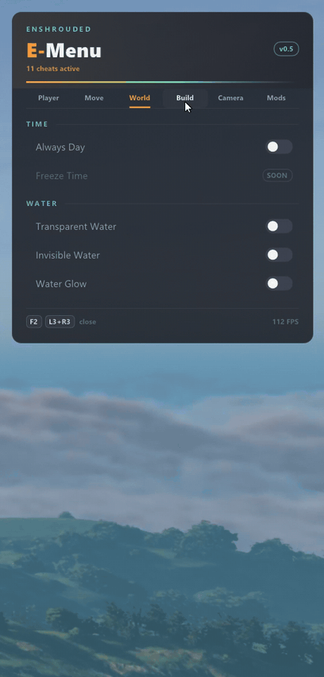

<br><br>

<table>
  <tr>
    <td align="center">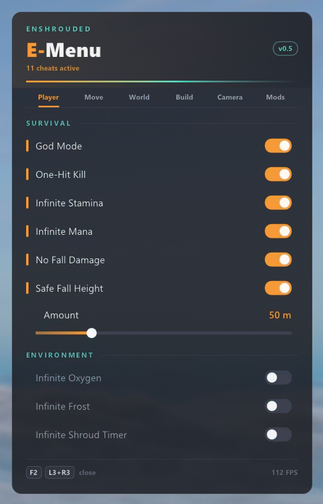<br><b>Player</b></td>
    <td align="center">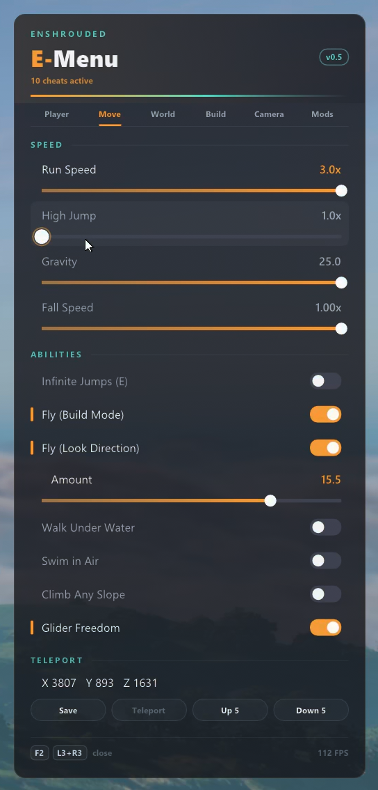<br><b>Move</b></td>
    <td align="center">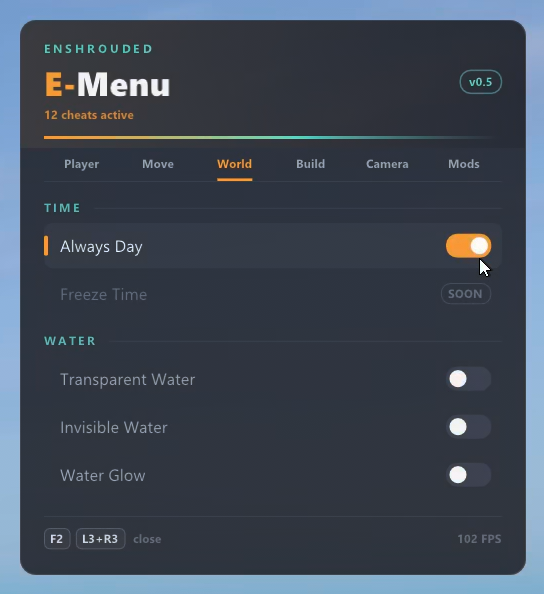<br><b>World</b></td>
  </tr>
  <tr>
    <td align="center">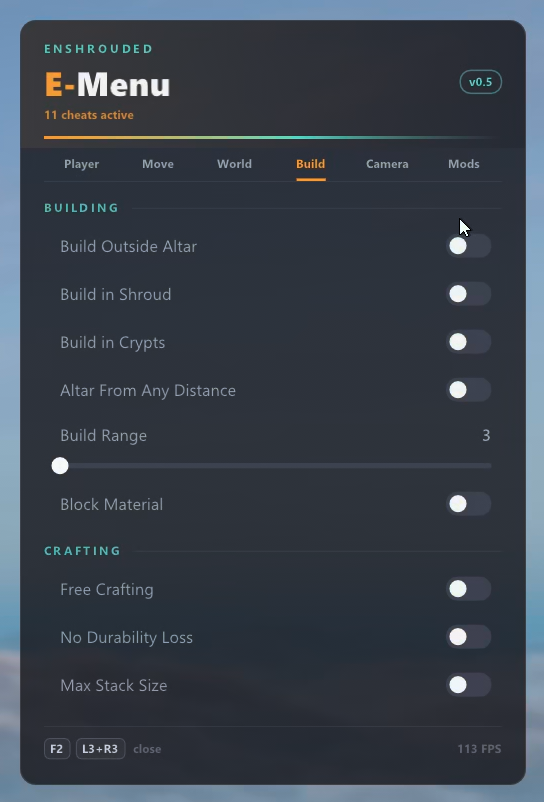<br><b>Build</b></td>
    <td align="center">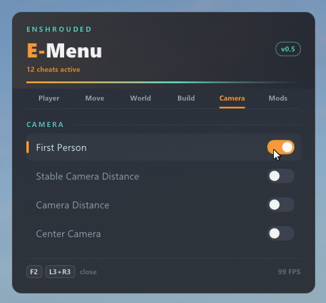<br><b>Camera</b></td>
    <td align="center">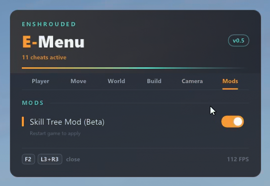<br><b>Mods</b></td>
  </tr>
</table>

</div>

---

## What it is

E-Menu is a Vulkan implicit layer that adds a glass style overlay menu to Enshrouded. Press **F2** (or **L3 + R3** on a controller) and the menu slides in on the right side of the screen. Every option takes effect immediately, and switching it off restores the original game code byte for byte.

- **No game files are modified.** The menu lives in its own DLL and is loaded by the Vulkan loader.
- **Pass-through everywhere else.** The layer only activates inside `enshrouded.exe`; every other Vulkan app sees an untouched pass-through layer.
- **Safe patching.** Every hook first verifies the original bytes. If a game update changed them, the option shows `N/A` instead of patching blind.
- **HDR aware.** On HDR10 displays the menu colours are re-encoded to PQ so white stays white instead of blinding.
- **Full controller support**, including Steam Input: the game stops receiving pad input while the menu is open.

## Features

| Tab | Options |
|---|---|
| **Player** | God Mode, One-Hit Kill, Infinite Stamina, Infinite Mana, No Fall Damage, Safe Fall Height, Infinite Oxygen, Infinite Frost, Infinite Shroud Timer |
| **Move** | Run Speed, High Jump, Gravity, Fall Speed, Infinite Jumps, Fly (Build Mode), Fly (Look Direction), Walk Under Water, Swim in Air, Climb Any Slope, Glider Freedom, Teleport (save, return, up, down) |
| **World** | Always Day, Transparent Water, Invisible Water, Water Glow |
| **Build** | Build Outside Altar, Build in Shroud, Build in Crypts, Altar From Any Distance, Build Range, Block Material, Free Crafting, No Durability Loss, Max Stack Size |
| **Camera** | First Person, Stable Camera Distance, Camera Distance, Center Camera |
| **Mods** | Toggle for a Skill Tree data mod (applies after a restart) |

Sliders return to their default value to switch an option off. Toggles with a value (Water Glow, Camera Distance, Block Material, Max Stack Size, Safe Fall Height, Fly) show their slider once switched on.

## Screenshots

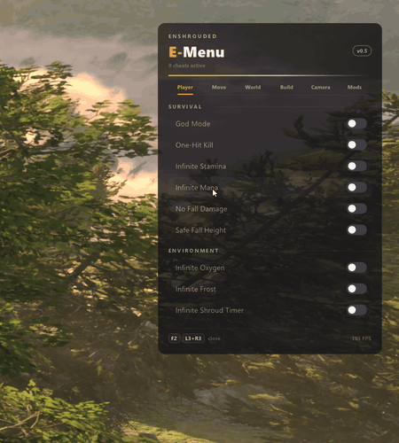

| | |
|---|---|
| 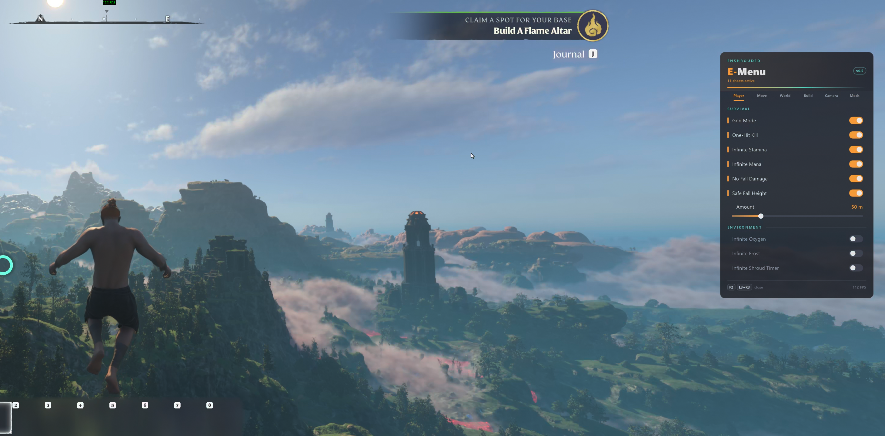 | 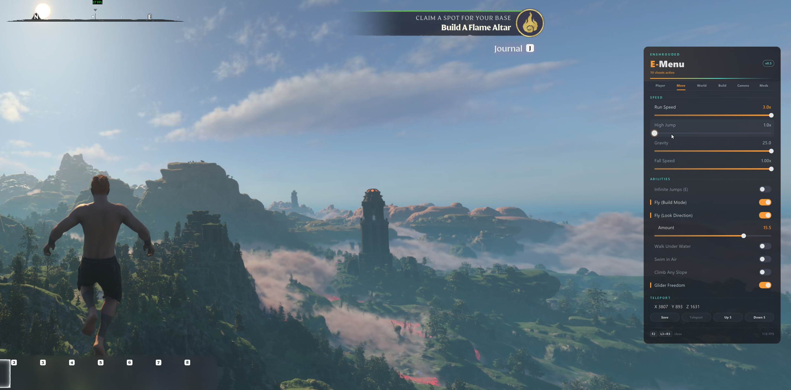 |
| 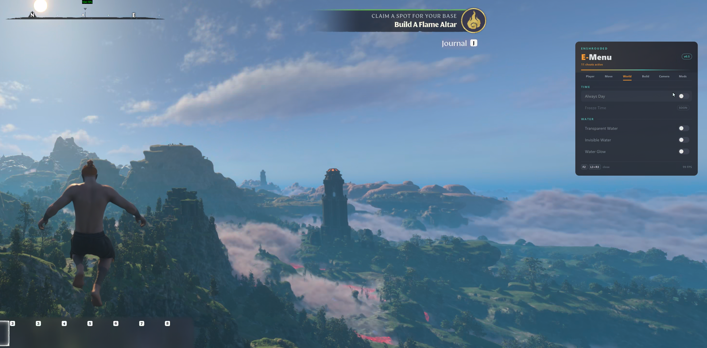 | 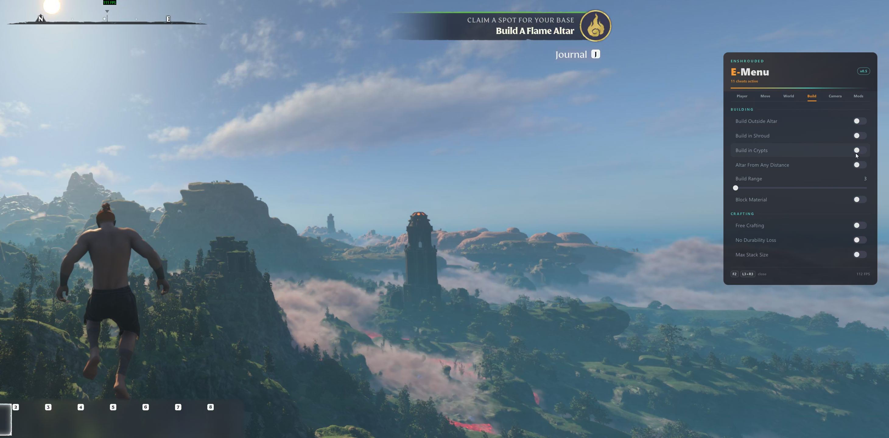 |
| 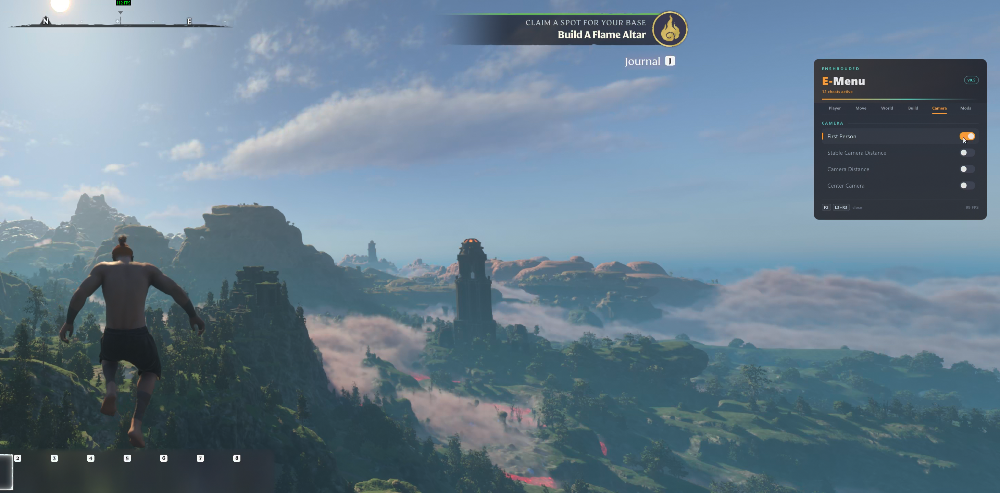 | 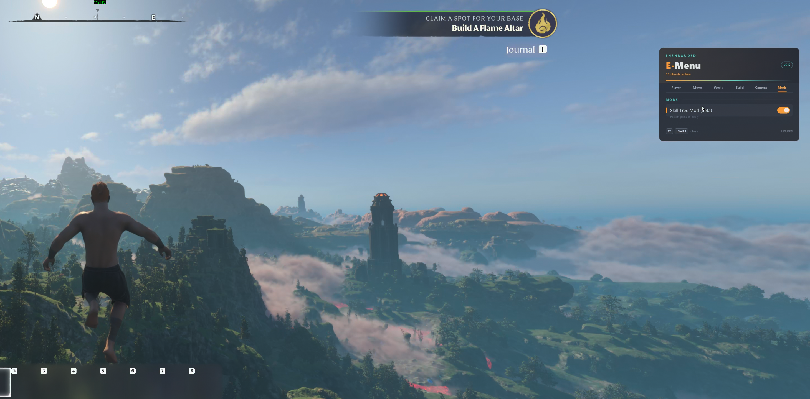 |

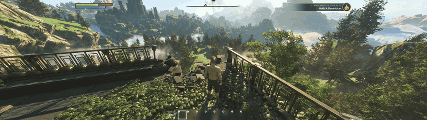

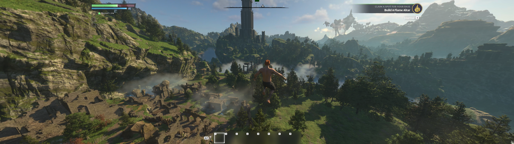

## Controls

| | Keyboard and mouse | Controller |
|---|---|---|
| Open / close | `F2` | `L3 + R3` (both sticks pressed), `B` closes |
| Move between rows | mouse | D-pad or left stick |
| Toggle / press | click | `A` |
| Change a slider | drag | left / right (hold to speed up) |
| Switch tab | click the tab | `LB` / `RB` |

While the menu is open the game does not receive keyboard, mouse or controller input, so your character stays put.

## Installation

### Installer (recommended)

1. Download `EnshroudedMenu-<version>.msi` from [Releases](../../releases/latest).
2. Run it. It installs for your Windows user only and needs no administrator rights. Nothing is placed in the game folder.
3. Start Enshrouded. A small `E-Menu` toast appears in the top right corner; press `F2`.

The installer is not code-signed, so Windows SmartScreen may show "Windows protected your PC". Click **More info**, then **Run anyway**.

**Uninstall:** Windows Settings → Apps → Installed apps → *E-Menu for Enshrouded* → Uninstall.
**Update:** run the newer `.msi`; it replaces the old version.

### Manual install

E-Menu is a regular Vulkan implicit layer: one DLL plus its JSON manifest. The `.zip` on the Releases page contains both plus an `INSTALL.txt`.

1. Build `EnshroudedMenu.dll` (see below), or take it from the release `.zip`.
2. Put `EnshroudedMenu.dll` and `layer/EnshroudedMenu.json` together in a folder, for example `%LOCALAPPDATA%\EnshroudedMenu\layer\`.
3. Register the manifest for your user: add a `DWORD` value named after the full path of the JSON file, with data `0`, under

   ```
   HKEY_CURRENT_USER\Software\Khronos\Vulkan\ImplicitLayers
   ```

4. Start Enshrouded. A small `E-Menu` toast appears in the top right corner; press `F2`.

**Uninstall:** delete the registry value and the folder.
**Disable temporarily:** set the environment variable `DISABLE_ENSHROUDED_MENU=1`.
**Log file:** `%LOCALAPPDATA%\EnshroudedMenu\menu.log`

## Building

Requirements:

- Windows x64, MSVC (Visual Studio 2022 or newer), C++20
- [Dear ImGui](https://github.com/ocornut/imgui) 1.91.9 with `backends/imgui_impl_vulkan`
- [Vulkan-Headers](https://github.com/KhronosGroup/Vulkan-Headers) 1.4.304

Build a 64-bit DLL from `src/*.cpp` plus the ImGui core and Vulkan backend sources, with:

- defines `VK_NO_PROTOTYPES`, `IMGUI_IMPL_VULKAN_NO_PROTOTYPES`, `VK_USE_PLATFORM_WIN32_KHR`, `WIN32_LEAN_AND_MEAN`, `NOMINMAX`
- `src/exports.def` as module definition file (it exports the layer entry points)
- link `user32`, `shell32`, `dinput8`, `dxguid`
- static CRT (`/MT`) recommended, so the DLL has no runtime dependency

Name the output `EnshroudedMenu.dll` so it matches `library_path` in the manifest.

## How it works

```
 enshrouded.exe ──► Vulkan loader ──► E-Menu layer ──► driver
                                       │
                                       ├─ vkQueuePresentKHR: draws the ImGui menu on the swapchain image
                                       ├─ input: raw input / cursor / Steam Input are paused while open
                                       └─ patch engine: pattern scan, code caves, verified writes
```

| Part | File |
|---|---|
| Layer entry points, instance and device tracking | `src/layer.cpp` |
| Overlay rendering, swapchain resources, HDR10 encoding | `src/overlay.cpp` |
| Menu look, tabs, rows, controller focus | `src/menu.cpp` |
| Option registry and all game hooks | `src/cheats.cpp` |
| Pattern scan, near allocation, thread-safe code writes, x64 emitter | `src/patch.cpp` |
| Keyboard, mouse and raw input handling | `src/input.cpp` |
| Controller reading and XInput hook | `src/gamepad.cpp` |
| Steam Input event interception | `src/steaminput.cpp` |
| Skill Tree mod toggle | `src/mods.cpp` |

Code is only patched while every other thread of the game is suspended and none of them is executing the bytes being replaced. Hooked functions jump into code caves placed within ±2 GB of the game module; all constants and slider values live in that cave page, never inside game structures. The one exception is Safe Fall Height: the fall heights sit in read-only game memory, so the cave only records where they are and the menu writes them once per frame (briefly unprotecting the range), restoring the originals when switched off.

## Notes

- Built and tested against the Steam version of Enshrouded 1.0.
- Meant for single player and your own worlds. On servers you do not own, the host decides what counts.
- A game update can move code around. Options whose patterns no longer match show `N/A` and stay off.
- Not affiliated with or endorsed by Keen Games.
